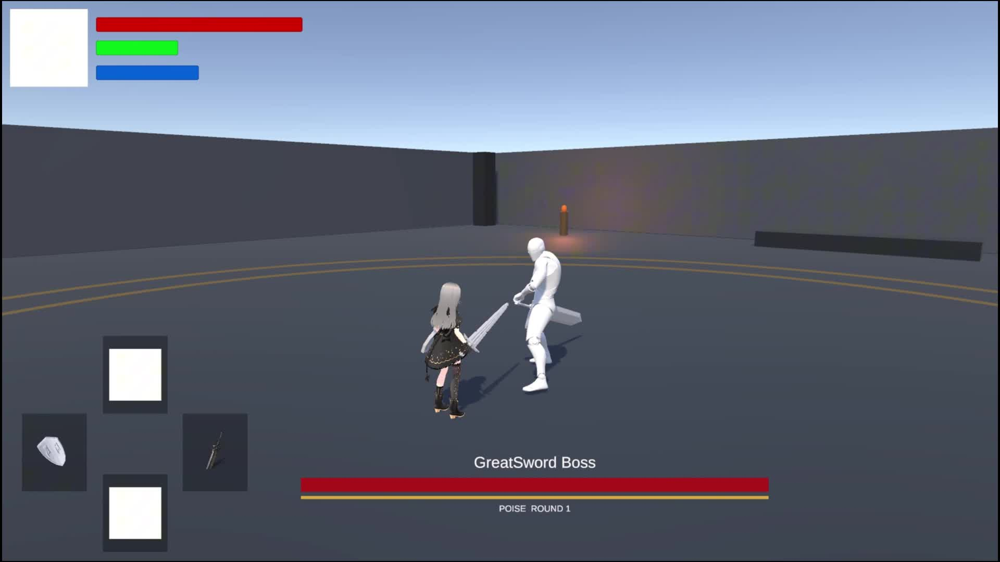

# SoullikeDemo

基于 Unity 制作的第三人称魂类战斗 Demo，主要展示玩家近战机制与双手大剑 Boss 战。

## 展示视频

[下载完整展示视频](https://github.com/xiaoxing-ssd/SoullikeDemo/releases/download/demo-showcase-2026-11-06/demo-showcase.mp4) · [查看视频与文档发布页](https://github.com/xiaoxing-ssd/SoullikeDemo/releases/tag/demo-showcase-2026-11-06)

视频时长约 9 分 49 秒，分辨率为 1920 × 1080，60 FPS。

## 主要内容

- **玩家战斗**：单手剑与双手大剑、普通连段、多次命中的战技、SP 与 MP 资源管理。
- **防御交互**：盾牌格挡、弹反、破防、闪避与精准闪避奖励。
- **伤害与受击**：攻击判定窗口、命中去重、攻击霸体、削韧、特殊受击和处决。
- **Boss 战**：可编辑行为树选择完整招式，状态机执行动画、根运动与伤害判定；包含二阶段、投技、突进和传送侧袭。
- **挑战流程**：篝火交互、雾门入场、死亡重试和 Boss 胜利提示。

## 设计文档

[下载 Demo 设计文档](docs/Demo设计文档.docx)

文档介绍战斗系统的 SO 配置、攻击与伤害结算、玩家战技、Boss 行为树及招式扩展方式。

## 当前发布内容

本仓库提供展示视频、设计文档和介绍截图。当前尚未提供可运行游戏包。

完整视频作为 Release 附件提供；点击上方链接可下载后观看。
